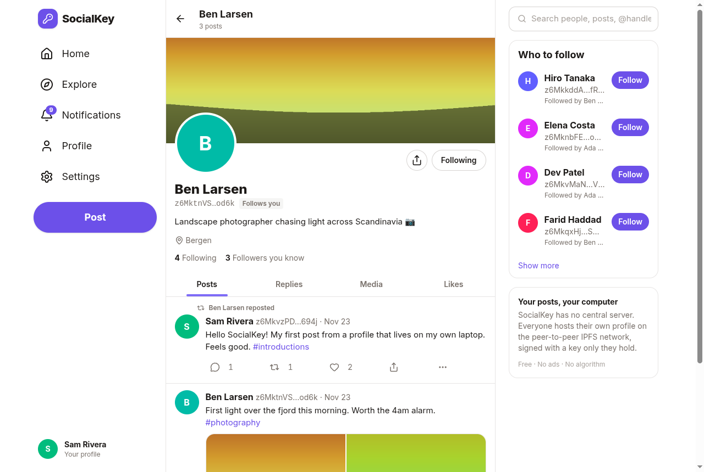
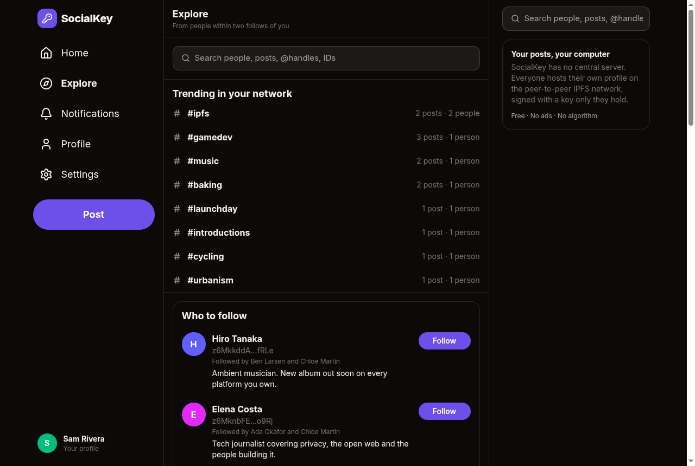
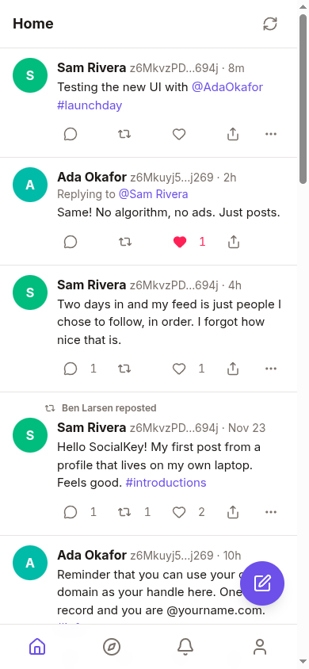

<div align="center">

# 🔑 SocialKey

**The social network you own.**

Post, follow friends and build a following, without a company in the middle.
Your profile lives on your computer, signed with a key only you hold, and is shared peer to peer over IPFS.


</div>

## Why SocialKey

Every big social network is somebody's database. They decide what you see, they can lock you out, and when they shut down your posts go with them.

SocialKey has no database and no server. Each person runs a small app that hosts their own profile:

- **Hosted by you.** Your posts are stored on your computer and served over the peer-to-peer IPFS network.
- **Signed by you.** Every post and profile update carries your Ed25519 signature. Nobody can fake a post from you, not even the nodes relaying it.
- **Kept online by your friends.** The people who follow you keep a copy of your recent posts and re-announce your profile, so it stays reachable while your computer is off. You do the same for them.
- **Your feed, in order.** Posts from the people you follow, newest first. No algorithm, no ads, no tracking.
- **Your domain, your name.** Prove you own a domain with one DNS record and use it as your handle, like `@alice.com`.
- **Portable identity.** Your identity is a key (`did:key`), not a username on someone's server.

## Features

| | |
|---|---|
|  |  |
| **Profiles** with banners, bios, pinned posts, and Posts / Replies / Media / Likes tabs | **Notifications** for replies, mentions, likes, reposts and new followers |
|  |  |
| **Explore**: people your friends follow, trending hashtags and posts from friends of friends | **A public website** anyone can visit, even without the app |

- Posts with up to 4 images, replies and threads, reposts and quotes, likes, @mentions with autocomplete, #hashtags
- Pin a post to your profile, delete posts (including old ones)
- Search people and posts across your network; paste an ID or `@handle` to open any profile
- Share your profile with a link or QR code
- Light and dark mode, and a mobile layout with a tab bar

<p align="center"></p>

## Getting started

### Use it

1. **Install the desktop app** for Windows (`SocialKey Setup.exe`) or Linux (`SocialKey.AppImage`). It includes everything, including its own IPFS node, and runs quietly in your system tray.
2. **Click _Open SocialKey_** in the app. Your timeline opens in your browser, already connected.
3. **Set up your profile** in Settings, then share your link or ID so friends can follow you.

On Windows, allow SocialKey through the firewall when asked, so others can reach your profile.

### Build it

Requires Node 22+ and [pnpm](https://pnpm.io).

```bash
pnpm install
pnpm test                                   # unit tests for core and agent
pnpm build                                  # build the web app
pnpm --filter @socialkey/desktop start      # run the desktop app
pnpm --filter @socialkey/desktop dist       # package for this OS (AppImage on Linux)
pnpm --filter @socialkey/desktop dist:win   # Windows installer (needs Wine on Linux)
```

To work on the web app against the command-line agent, run a Kubo daemon (`ipfs daemon`), then `pnpm dev`, and enter the pairing code the agent prints.

#### A demo network

`apps/agent/scripts/seed.ts` publishes nine demo people with profiles, posts, replies, likes, reposts and follows to a Kubo node, which is how the screenshots above were made:

```bash
KUBO_API=http://127.0.0.1:5001 pnpm --filter @socialkey/agent exec tsx scripts/seed.ts --dir /tmp/seed --main /tmp/demo-user
SOCIALKEY_DATA_DIR=/tmp/demo-user pnpm --filter @socialkey/agent dev
```

For fast local testing, run Kubo with `ipfs daemon --offline`: it resolves the demo profiles itself.

## How it works

```
 your computer                                     the IPFS network
┌──────────────────────────────────┐
│ SocialKey app                    │   signed manifest   ┌──────────────┐
│  ├─ your Ed25519 key             │ ──────────────────▶ │ IPNS: k51…   │ ◀── anyone resolves your
│  ├─ agent: signs & publishes     │   posts, images     │ (your name)  │     did:key → IPNS name
│  └─ Kubo IPFS node               │ ──────────────────▶ │ CIDs         │
└──────────────────────────────────┘                     └──────────────┘
          ▲ local API                                           ▲
          │                                                     │ followers pin your posts and
   web app in your browser  ◀──── verified fetches ─────────────┘ re-announce your IPNS record
```

- **Identity.** One Ed25519 key is your identity (`did:key:z6Mk…`), your signing key and your IPNS name.
- **Profile manifest.** Your IPNS name points to a signed DAG-JSON manifest: your profile, who you follow, your 50 most recent posts (older ones in a linked chain of pages), likes and a pinned post.
- **Posts** are immutable, signed DAG-JSON objects addressed by CID. Images are stored as separate files.
- **Verification.** Clients check every manifest and post signature before showing it, and check every block against its CID.
- **Timeline and discovery** are computed in your browser from the profiles of people you follow and the people they follow. There is no central index.

See [`CLAUDE.md`](CLAUDE.md) for the full architecture and conventions.

## Project layout

```
packages/core   shared data model: schemas, signing, did:key ↔ IPNS, handles
apps/agent      local service that holds your key, publishes via Kubo, hosts your follows
apps/web        the web app (Vite + React + Tailwind)
apps/desktop    Electron app bundling Kubo, the agent and the web app, with a tray icon
```

## Status and limits

SocialKey is early software. Things to know:

- **No central index**, so search, notifications and follower counts only cover people within two follows of you.
- **Visitors without the app** read profiles through public IPFS gateways. That works best while the profile's owner, or one of their followers, is online.
- **Not yet built:** direct messages, real-time updates, a mobile app, code-signed installers and auto-update.
- **Deleting a post** removes it from your profile and your node, but people who already fetched it may still have a copy, as on any network.
