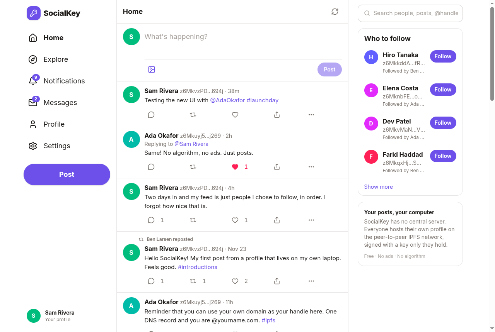
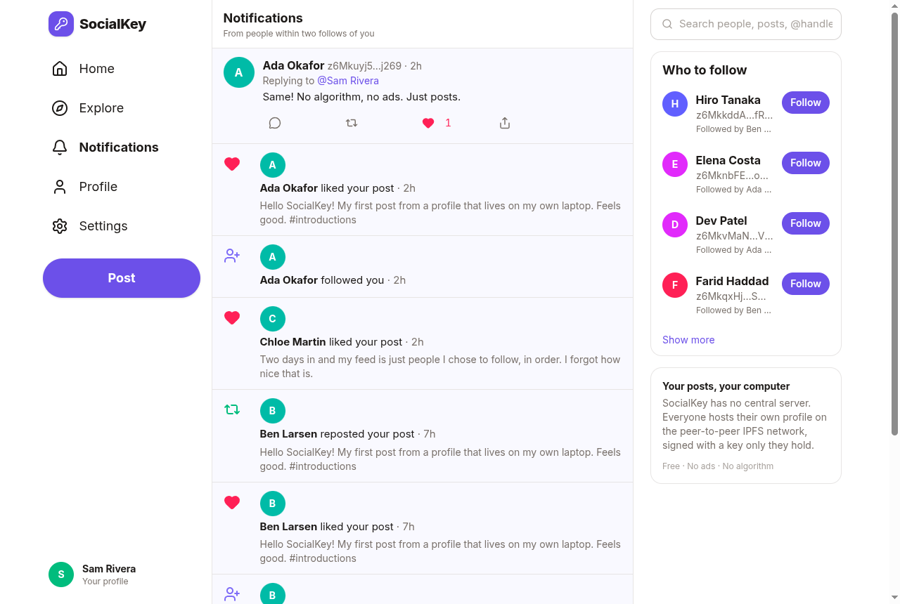
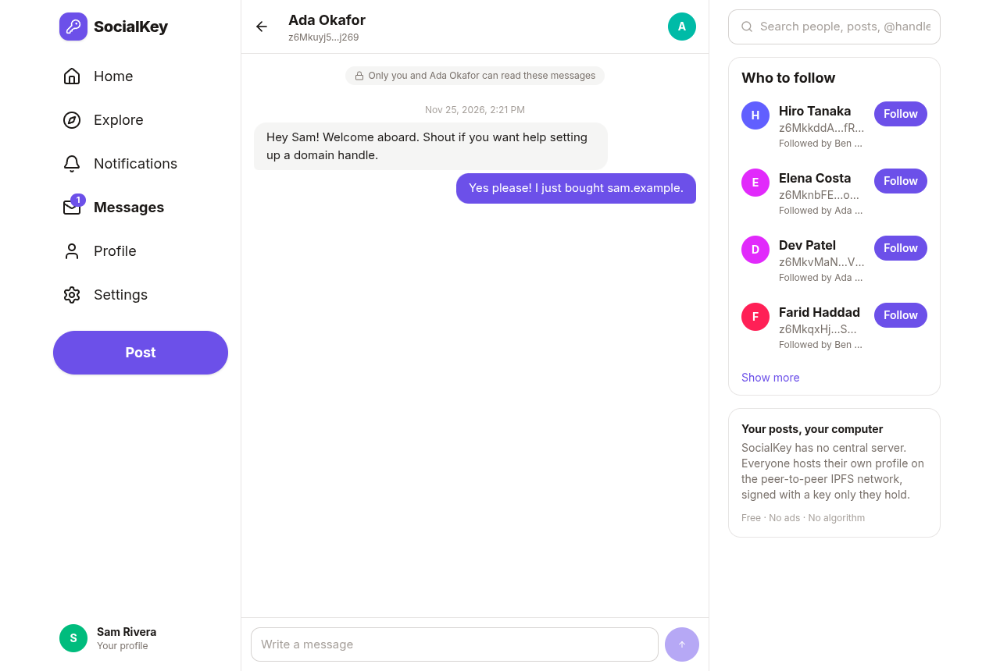
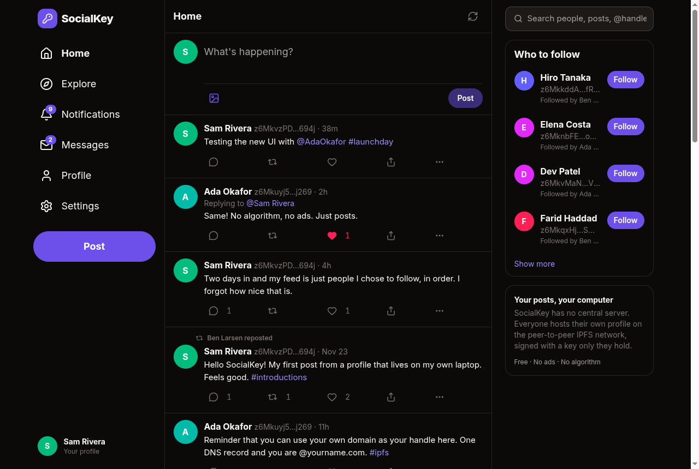
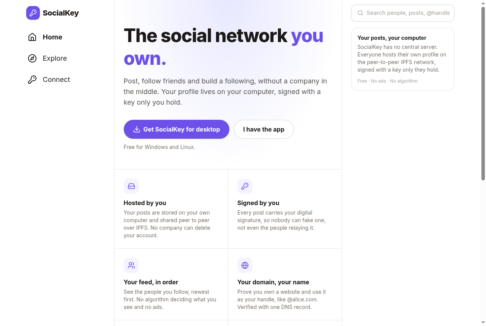
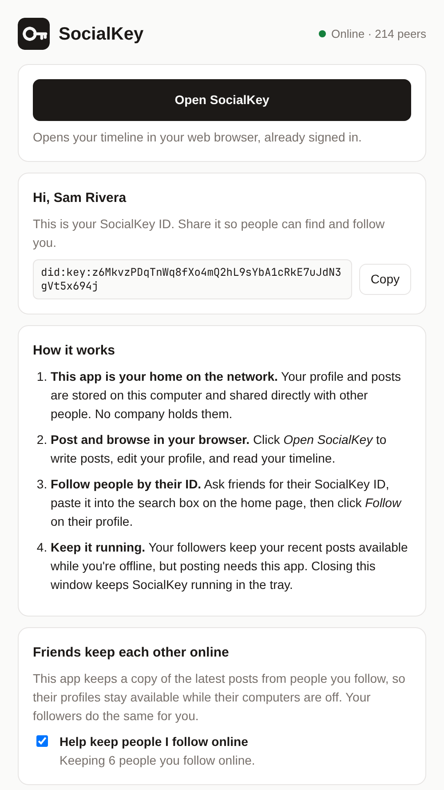
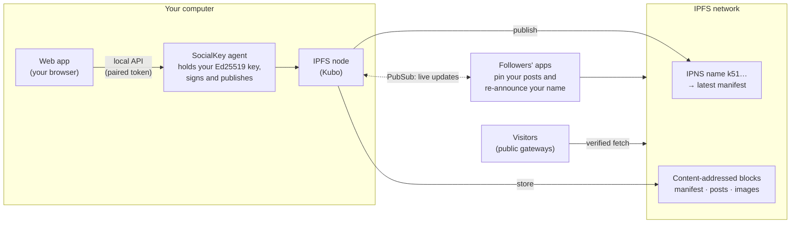

<div align="center">


# SocialKey

### The social network you own.

Post, follow friends and build a following, with no company in the middle.<br>
Your profile lives on your own computer, signed with a key only you hold, and is shared peer to peer over IPFS.

[](https://github.com/HerbAvenue/SocialKey/actions/workflows/ci.yml)
[](https://github.com/HerbAvenue/SocialKey/releases)


[**Download**](https://github.com/HerbAvenue/SocialKey/releases) ·
[Features](#features) ·
[How it works](#how-it-works) ·
[Security](#security-model) ·
[Development](#development) ·
[FAQ](#faq)

<br>



</div>

<br>

## Why SocialKey

Every big social network is somebody else's database. The company decides what you see, can lock you out of your own account, and when it shuts down your posts go with it.

SocialKey has **no central server and no database.** Each person runs a small desktop app that hosts their own profile, and everyone's profiles together make up the network.

| | Typical social platform | SocialKey |
|---|---|---|
| **Where your posts live** | The company's data centre | Your computer, shared peer to peer over IPFS |
| **Who controls your account** | The company | You: your identity is a cryptographic key |
| **What's in your feed** | An engagement algorithm and ads | The people you follow, newest first |
| **Proof of authorship** | Trust the platform | Every post carries your Ed25519 signature |
| **Private messages** | Readable by the platform | End-to-end encrypted, with no server involved |
| **Your username** | Rented from the platform | Your own domain, like `@alice.com`, or a key nobody can take |
| **If the service shuts down** | Your content is gone | Nothing to shut down: your profile is yours |

## Features

<table>
  <tr>
    <td width="50%" valign="top">
      <br>
      <b>Profiles</b> with banners, bios, a pinned post, and Posts / Replies / Media / Likes tabs.
    </td>
    <td width="50%" valign="top">
      <br>
      <b>Notifications</b> for replies, mentions, likes, reposts and new followers.
    </td>
  </tr>
  <tr>
    <td valign="top">
      <br>
      <b>Explore</b>: people your friends follow, trending hashtags and posts from friends of friends.
    </td>
    <td valign="top">
      <br>
      <b>Encrypted messages</b>, stored on your own computers and readable only by the two of you.
    </td>
  </tr>
  <tr>
    <td valign="top">
      <br>
      <b>Light and dark mode</b>, following your system setting.
    </td>
    <td valign="top">
      <br>
      <b>A public website</b> anyone can browse, even without the app.
    </td>
  </tr>
</table>

### Everything you'd expect from a social network

- **Posting:** text with up to 4 images, replies and threads, reposts and quote posts, `@mentions` with autocomplete, `#hashtags`
- **Engagement:** likes, reply / repost / like counts, pinned posts, and deleting posts (including old ones)
- **Discovery:** who to follow, trending hashtags, and search across people and posts in your network. Paste an ID or `@handle` to open any profile.
- **Real-time:** new posts from people you follow arrive in about a second, pushed peer to peer over libp2p PubSub
- **Safety:** mute and block, kept in private lists that never leave your computer
- **Sharing:** share your profile with a link or QR code
- **Your domain as your name:** prove you own a domain with one DNS record and use it as your handle
- **Backup and restore:** a 24-word recovery phrase brings your identity back on any computer, and your profile comes back from the network

### A desktop app anyone can use



You don't need to know what IPFS is. The SocialKey desktop app bundles everything: its own IPFS node, the agent that signs and publishes your posts, and the web app.

- **One click to start.** _Open SocialKey_ opens your timeline in your browser, already signed in.
- **Lives in the system tray.** Closing the window keeps it running quietly in the background, and it can start when you log in.
- **Friends keep each other online.** The app keeps a copy of the latest posts from people you follow, so their profiles stay reachable while their computers are off. Your followers do the same for you.
- **Use it from your phone.** Turn on _Allow devices on my network_ and scan the QR code to use SocialKey from a phone on the same Wi-Fi.
- **Never clashes** with an IPFS node you already run: it uses its own repository and ports.


<br clear="right">

## Getting started

### Install the app

1. **Download** the installer for your system from the [**Releases page**](https://github.com/HerbAvenue/SocialKey/releases):

   | System | File |
   |---|---|
   | Windows 10 / 11 | `SocialKey Setup <version>.exe` |
   | Linux | `SocialKey-<version>.AppImage` (make it executable, then run it) |
   | macOS | `SocialKey-<version>.dmg` (experimental) |

2. **Click _Open SocialKey_** in the app window. Your timeline opens in your browser.
3. **Set up your profile** in Settings: name, bio, avatar and banner.
4. **Find people.** Share your link or QR code, and paste a friend's ID into search to follow them.
5. **Back up your key.** Write down your 24-word recovery phrase from the app. It is the only way to recover your account.

> [!NOTE]
> Installers aren't code-signed yet. Windows SmartScreen may show "Windows protected your PC": click **More info → Run anyway**. On macOS, right-click the app and choose **Open**. On Windows, allow SocialKey through the firewall when asked, so other people can reach your profile.

### Just browsing

Anyone can open the SocialKey website to read public profiles and posts, with nothing installed. Content is fetched from public IPFS gateways and verified in the browser. Posting needs the app, because that's where your key lives.

## How it works



1. **Your identity is a key.** One Ed25519 key pair is your identity (`did:key:z6Mk…`), your signing key and your IPNS name, all at once. Nobody issues it and nobody can revoke it.
2. **Your profile is a signed manifest.** Your IPNS name points to a signed DAG-JSON document holding your profile, who you follow, your 50 most recent posts (older ones in a linked chain of pages), your likes and your pinned post.
3. **Posts are immutable.** Each post is a signed object addressed by its content hash (CID). Images are stored as separate IPFS files.
4. **Updates spread two ways.** Every change is announced at once over libp2p PubSub to followers who are online (about a second), and published to IPNS for everyone else (about a minute).
5. **Friends keep each other online.** Each app pins the recent posts of the people it follows and re-announces their signed IPNS records, so a profile stays reachable while any follower is online.
6. **Your timeline is computed in your browser** from the profiles of people you follow and the people they follow. There is no central index, no ranking and nothing to sell.

## Security model

- **Nothing is trusted on the way in.** Every block fetched from any gateway is checked against its CID, every IPNS record against its V2 signature and expiry, and every manifest and post against its author's signature, before anything is shown.
- **Your key never leaves the agent.** The browser talks to it through a local API, after pairing with a one-time code. Only SHA-256 hashes of access tokens are stored, and wrong codes are rate-limited.
- **Signatures cover the whole object**, including fields that future versions add, so old clients can still verify new posts.
- **Direct messages** use X25519 key agreement derived from both people's keys, HKDF, and XChaCha20-Poly1305 with the sender's ID as associated data. Each message is labelled with a tag that only the two people in the conversation can compute, so outsiders can't even tell who it's for.
- **Handles are verified, never assumed.** `@alice.com` is shown only after a DNS-over-HTTPS lookup confirms that `_socialkey.alice.com` holds a TXT record naming that key.
- **Mute and block lists are private.** They're stored only on your computer and never published.
- **Restoring an account never destroys a key.** The previous identity is archived, not deleted.

## Built with

| Area | Technology |
|---|---|
| Language | TypeScript (strict), ESM, one shared codebase across all apps |
| Web app | React 19, Vite, Tailwind CSS v4, TanStack Query, React Router |
| Agent | Node.js, Fastify |
| Desktop | Electron with a bundled [Kubo](https://github.com/ipfs/kubo) IPFS node |
| Data | IPFS, IPNS, DAG-JSON (`@ipld/dag-json`), `multiformats`, `zod` validation |
| Cryptography | `@noble/curves` (Ed25519, X25519), `@noble/ciphers` (XChaCha20-Poly1305), `@noble/hashes`, `@scure/bip39` |
| Quality | Vitest, Biome, GitHub Actions CI with cross-platform release builds |

The browser app talks to IPFS with plain `fetch` calls to trustless gateways and verifies everything itself. It doesn't need a JavaScript IPFS node, so it stays small and loads fast.

## Development

Requires **Node 22+** and [**pnpm**](https://pnpm.io).

```bash
pnpm install
pnpm test                                   # unit tests (core, agent, web)
pnpm typecheck
pnpm lint                                   # Biome; `pnpm format` to autofix
pnpm build                                  # build the web app
pnpm --filter @socialkey/desktop start      # run the desktop app
pnpm --filter @socialkey/desktop dist       # package for this OS
pnpm --filter @socialkey/desktop dist:win   # Windows installer (needs Wine on Linux/macOS)
```

To work on the web app against the command-line agent, start an IPFS daemon (`ipfs init` once, then `ipfs daemon`), run `pnpm dev`, and enter the pairing code the agent prints.

<details>
<summary><b>Run a demo network</b></summary>

<br>

`apps/agent/scripts/seed.ts` publishes nine demo people with profiles, posts, replies, likes, reposts, follows and messages. That's how the screenshots above were made.

```bash
ipfs daemon --offline     # resolves the demo profiles locally, in seconds
KUBO_API=http://127.0.0.1:5001 pnpm --filter @socialkey/agent exec tsx scripts/seed.ts --dir /tmp/seed --main /tmp/demo-user
SOCIALKEY_DATA_DIR=/tmp/demo-user pnpm --filter @socialkey/agent dev
```

</details>

<details>
<summary><b>Releasing</b></summary>

<br>

- **Installers:** push a tag like `v0.6.0`. The Release workflow builds the Windows, macOS and Linux apps, each on its own OS, and attaches them to a draft GitHub release.
- **The website, on IPFS:** build with `VITE_PUBLIC_URL` (where the site will live, used in share links) and `VITE_DOWNLOAD_URL` (your releases page), then run `pnpm --filter @socialkey/web publish:ipfs`. It prints the CID, gateway links and the DNSLink record for serving it from your own domain.

</details>

<details>
<summary><b>Configuration</b></summary>

<br>

| Variable | Default | Purpose |
|---|---|---|
| `SOCIALKEY_PORT` | `4040` | Agent API port |
| `KUBO_API` | `http://127.0.0.1:5001` | Kubo RPC address |
| `KUBO_GATEWAY` | `http://127.0.0.1:8080` | Kubo gateway address |
| `SOCIALKEY_DATA_DIR` | `~/.socialkey` | Key, manifest and settings |
| `SOCIALKEY_ORIGINS` | | Extra allowed CORS origins |
| `SOCIALKEY_WEB_ROOT` | | Serve a built web app at `/app/` |
| `SOCIALKEY_HOST_FOLLOWS` | `true` | Keep followed profiles online |
| `SOCIALKEY_LAN` | `false` | Accept connections from the local network |
| `VITE_GATEWAYS`, `VITE_ROUTERS` | public defaults | Gateways and routers the web app reads from |

See [`apps/web/.env.example`](apps/web/.env.example) for all web settings.

</details>

### Project layout

```
packages/core   shared data model: schemas, signing, did:key ↔ IPNS, encryption, handles (no I/O)
apps/agent      local service: holds your key, publishes through Kubo, hosts your follows
apps/web        the web app (React + Vite + Tailwind), hostable on IPFS itself
apps/desktop    Electron app bundling Kubo, the agent and the web app, with a tray icon
```

[`CLAUDE.md`](CLAUDE.md) documents the full architecture, data model and conventions.

## Roadmap

- [x] Signed profiles, posts, replies, reposts, quotes, likes and pinned posts
- [x] End-to-end encrypted direct messages
- [x] Friends keep each other online (pinning and IPNS re-announcing)
- [x] Real-time updates over libp2p PubSub
- [x] Domain handles, recovery phrases, mute and block
- [x] Desktop app for Windows and Linux, with phone access over Wi-Fi
- [ ] Code-signed installers and automatic updates
- [ ] Native mobile app
- [ ] Posting from the browser alone, with no desktop app
- [ ] Opt-in indexers for network-wide search and discovery

## Status and limits

SocialKey is **early software**. It works on the live IPFS network today, but be aware of the following:

- **No central index**, so search, notifications and follower counts only cover people within two follows of you.
- **First loads can be slow for visitors.** In a test on the live network, a profile hosted on a home computer behind a router loaded for a first-time visitor in about 30 seconds. After that it's cached and quick. A profile is reachable while its owner, or one of their followers, is online.
- **Messages from strangers** show up only once they're within two follows of you, or after you've messaged them first.
- **Deleting a post** removes it from your profile and your node, but people who already fetched it may still have a copy, as on any network.

## FAQ

<details>
<summary><b>Is it free? Are there ads?</b></summary>
<br>
Yes, it's free, and there are no ads and no tracking. There's no company server to pay for: each person's computer hosts their own profile.
</details>

<details>
<summary><b>Do I need to keep my computer on?</b></summary>
<br>
Your followers' apps keep your recent posts available while your computer is off. You need the app running to post or to change your profile.
</details>

<details>
<summary><b>What happens if I lose my computer?</b></summary>
<br>
Install SocialKey on a new computer and restore with your 24-word recovery phrase. Your identity comes back, and your profile is fetched from the network. Without the phrase, nobody (including us) can recover the account.
</details>

<details>
<summary><b>Can someone fake a post from me?</b></summary>
<br>
No. Every post is signed with your private key, and every client checks the signature before showing it. A gateway or relay that changes a single byte is caught.
</details>

<details>
<summary><b>Is this a blockchain or crypto project?</b></summary>
<br>
No. There's no token, no coin and no blockchain. SocialKey uses IPFS for content-addressed storage and IPNS for mutable profile pointers.
</details>

<details>
<summary><b>Can I use my phone?</b></summary>
<br>
Yes, while it's on the same Wi-Fi as your computer: turn on <i>Allow devices on my network</i> in the desktop app and scan the QR code. A native mobile app is on the roadmap.
</details>

## License

A license hasn't been chosen yet, so all rights are reserved for now.
